# RoadSense: Master Plan (Configure 2026)

> **One-liner:** Every connected vehicle becomes a road sensor. RoadSense combines CAN, IMU and GPS data from many vehicles in real time on **Condense**. It confirms potholes, waterlogging, slippery patches and sudden-braking hotspots. It warns drivers who are approaching the hazard and opens repair tickets with the city. Each hazard **clears itself** once vehicles drive over that spot smoothly again.

Files in this folder:

| File | What it is |
|---|---|
| `01_MASTER_PLAN.md` | This file: problem, architecture, timeline, judging map, submission checklist |
| `02_CONDENSE_PLATFORM_GUIDE.md` | Exactly what to click and configure on the Condense platform |
| `03_KIRO_PROMPTS.md` | Ordered prompts to paste into Kiro, one per build step |
| `kiro-steering/*.md` | Copy into your repo as `.kiro/steering/` so Kiro always knows the contracts and algorithms |

---

## 1. Problem, user, why real time

- **Problem:** Indian roads have hazards that change by the hour: potholes after rain, waterlogged underpasses, oil spills, stray cattle, broken dividers. Pothole crashes killed **2,385 people in India in 2024** (the highest on record), and **9,438 between 2020 and 2024**, up 53% (MoRTH figures reported to Parliament, Feb 2026). Today these hazards reach the city through citizen complaints days later, and drivers learn about them by hitting them.
- **Users:**
  1. **Drivers and fleet operators.** They get a warning such as "Pothole in 300 m, slow to 20 km/h" *before* they reach the hazard.
  2. **City road-maintenance teams** (municipal ward engineers). They get a confirmed, prioritised work-order queue with evidence and repair-time tracking.
  3. **Fleet managers.** Vehicle damage and downtime go down.
- **Why it must be real time:** A warning is only useful in the 10–30 seconds before a vehicle reaches the hazard. Waterlogging appears and disappears within an hour, so a batch report the next day is useless.
- **Industry validation:** Bosch already runs a road-hazard service that combines data from many vehicles in Europe (low grip, heavy rain, low visibility, broken-down vehicles), in a European carmaker's fleet and in Mercedes-Benz Trucks. **RoadSense targets the hazards that dominate Indian roads: potholes, waterlogging, speed-breaker confusion and sudden-braking hotspots.** Say this in the pitch, because Bosch MPS is on the jury.

## 2. What makes this top-3 material

1. **Agreement across vehicles, not single-vehicle guesses.** A hazard is confirmed only when several *different* vehicles agree. Each vehicle's report is weighted by that vehicle's **reputation**.
2. **Self-healing hazard lifecycle:** CANDIDATE → CONFIRMED → DECAYING → CLEARED. Vehicles passing smoothly count as evidence *against* a hazard.
3. **Faulty-sensor immunity.** One "chaos" vehicle spams fake bumps. Its reputation collapses, it is quarantined, and no false hazard is created. Show this live.
4. **Live, measured accuracy.** The simulator knows where the real hazards are, and the dashboard shows **precision, recall, mean time-to-detect and end-to-end latency (p50/p95)** live. Almost no hackathon team measures accuracy.
5. **Speed-breaker vs pothole classification.** Drivers slow down *before* a speed breaker, but a pothole is a surprise. Detection uses that pre-braking pattern.
6. **Stateful stages that scale horizontally.** Stages are keyed by vehicle ID or H3 cell, so stateful operators get partition affinity and can scale out. State is rebuilt from a compacted Kafka topic after a restart.
7. **Closed loop.** A city worker marks a hazard "repaired" → the simulator repairs the road → vehicles pass smoothly → the hazard clears itself → the ticket closes with a measured repair time.

## 3. Architecture

```mermaid
flowchart LR
  subgraph EDGE["Vehicle simulator (Python, 150-300 vehicles, Bengaluru OSM roads)"]
    SIM[Vehicle simulator<br/>GPS + CAN + IMU @1-2 Hz]
    GT[Ground-truth<br/>hazard registry]
  end
  SIM -- MQTT TLS rs/telemetry/# --> BROKER[(Public MQTT broker<br/>HiveMQ Cloud / EMQX)]
  BROKER --> C1

  subgraph CONDENSE["CONDENSE workspace (streaming backbone)"]
    C1[[1 MQTT Input connector]] --> T0[(prefix.telemetry.raw)]
    T0 --> A1[2 rs-normalize<br/>custom transform]
    A1 --> T1[(prefix.telemetry.clean)]
    A1 --> TD[(prefix.telemetry.dlq)]
    T1 --> A2[3 rs-detect<br/>per-vehicle stateful]
    A2 --> T2[(prefix.road.events<br/>key = h3 cell)]
    T2 --> A3[4 rs-fuse<br/>multi-vehicle agreement + reputation]
    A3 --> T3[(prefix.hazards.state<br/>compacted, key = hazard_id)]
    A3 --> TR[(prefix.vehicles.reputation<br/>compacted)]
    T3 --> A4[5 rs-alert<br/>proximity warning router]
    TR --> A4
    T1 --> A4
    A4 --> T4[(prefix.ui.events)]
    T3 --> U1{{6 Split utility<br/>severity/status routing}}
    U1 --> T5[(prefix.hazards.critical)]
    U1 --> T6[(prefix.hazards.minor)]
    T5 --> U2{{7 Data utility<br/>ticket payload shaping}}
    U2 --> T7[(prefix.city.tickets)]
    T3 --> O1[[8 PostgreSQL Output<br/>upsert hazards]]
    T4 --> O2[[9 HTTP Output -> API /ingest/ui-events]]
    T7 --> O3[[10 HTTP Output -> API /ingest/tickets]]
  end

  O1 --> PG[(Postgres + PostGIS<br/>Neon / Supabase)]
  O2 --> API[FastAPI gateway<br/>WebSocket hub + scoring]
  O3 --> API
  API <--> PG
  GT -- HTTPS --> API
  API -- MQTT rs/control --> BROKER
  BROKER -- control --> SIM
  API -- WebSocket --> UI[React dashboard<br/>MapLibre + deck.gl H3]
```

**Component budget:** 10 Condense components, which is exactly the limit. **On Saturday morning, ask in #condense-help whether transforms and utilities count toward the 10-connector limit.** If they do, use the **lean build** instead: drop #7 (Data utility) and have the API shape the ticket. Optionally also drop #6 (Split) and have rs-fuse write `hazards.critical` directly. That leaves 8.

### 3.1 Kafka topics (replace `prefix` with your team prefix)

| Topic | Key | Partitions | Cleanup | Producer → Consumer |
|---|---|---|---|---|
| `prefix.telemetry.raw` | vehicle_id | 3 | delete, 6 h | MQTT In → rs-normalize |
| `prefix.telemetry.clean` | vehicle_id | 3 | delete, 6 h | rs-normalize → rs-detect, rs-alert |
| `prefix.telemetry.dlq` | vehicle_id | 1 | delete, 24 h | rs-normalize → (inspection) |
| `prefix.road.events` | h3 res-9 parent cell | 3 | delete, 24 h | rs-detect → rs-fuse (one observation per vehicle per cell traversal; an empty observation counts as a clean pass, i.e. negative evidence) |
| `prefix.hazards.state` | hazard_id | 3 | **compact** | rs-fuse → rs-alert, Split, PG Out |
| `prefix.vehicles.reputation` | vehicle_id | 1 | **compact** | rs-fuse → rs-alert (and rs-fuse itself, to recover state after a restart) |
| `prefix.hazards.critical` | hazard_id | 1 | delete | Split → Data utility |
| `prefix.hazards.minor` | hazard_id | 1 | delete | Split → (analytics) |
| `prefix.city.tickets` | hazard_id | 1 | delete | Data utility → HTTP Out |
| `prefix.ui.events` | hazard_id / vehicle_id | 1 | delete, 6 h | rs-alert → HTTP Out |

Use partition counts and retention within the published usage limits. Lower them if the limits are tighter.

### 3.2 Why each stage exists (say this in the video)

| Stage | Responsibility | Key technique |
|---|---|---|
| rs-normalize | Validate the schema, normalize units, reject impossible physics (teleport > 200 km/h implied, accel > 6 g), drop late events (> 30 s), dedupe, add H3 cells | Pydantic validation, DLQ with reason codes, event-time |
| rs-detect | Per-vehicle anomaly detection: pothole, speed breaker, waterlogging, slippery patch, sudden-braking spot | EWMA baseline z-score, speed-scaled thresholds, pre-braking signature, re-keying by H3 |
| rs-fuse | Combine evidence across vehicles into hazards | Noisy-OR confidence, reputation weighting, negative evidence from clean passes, lifecycle state machine, compacted-topic state recovery |
| rs-alert | Warn vehicles approaching confirmed hazards | H3 k-ring lookup, bearing filter (ahead and same direction), per-(vehicle, hazard) cooldown, advisory speed |
| Split (no-code) | Route CONFIRMED + HIGH/CRITICAL hazards to city tickets | Condense rule groups |
| Data utility (no-code) | Shape the ticket payload (department, SLA hours, priority) | Condense field ops |
| PG Out | Durable history for SLA and analytics | Upsert `ON CONFLICT (hazard_id)` |
| HTTP Out ×2 | Push to the gateway | Batch + retry |

## 4. Tech stack (declare all of it in the submission)

| Layer | Choice |
|---|---|
| Simulator | Python 3.11, asyncio, `paho-mqtt`, `osmnx` (precompute a Bengaluru road graph: Koramangala/HSR area; OSM data © OpenStreetMap contributors, ODbL), `numpy` |
| Transforms | Python 3.11, `confluent-kafka`, `h3` v4, `pydantic` v2, `orjson`; one Docker image, role selected with the `RS_ROLE` env var |
| MQTT broker | HiveMQ Cloud free tier or EMQX Serverless free (TLS 8883). It must be publicly reachable by the Condense MQTT connector |
| API gateway | FastAPI, uvicorn, WebSockets, `asyncpg`, `paho-mqtt`; deploy on Render, Railway or Fly (needs public HTTPS for the HTTP Output connectors) |
| Database | Postgres 16 + PostGIS on Neon or Supabase (free) |
| Frontend | React + Vite + TypeScript, MapLibre GL, deck.gl `H3HexagonLayer`, Tailwind, Recharts; deploy on Vercel |
| AI tools | Kiro (and Claude for planning). Disclose both in the submission |

## 5. Dashboard screens (demo script)

1. **Live map:** vehicles as moving dots, H3 hexes coloured by hazard confidence, with pulsing hexes for new CONFIRMED hazards.
2. **Driver view:** follow one vehicle. A head-up banner shows "⚠ Pothole in 280 m, slow to 20 km/h", with a countdown as it approaches.
3. **City ops board:** ticket queue (critical first), evidence (number of vehicles, confidence, first and last seen), how long each hazard has been open, and a "Mark repaired" button.
4. **Accuracy scoreboard:** precision, recall, F1, mean time-to-detect, false hazards prevented, and quarantined vehicles.
5. **Pipeline health:** messages/sec per stage, end-to-end latency p50/p95 (vehicle timestamp → UI receive), and DLQ count by reason.
6. **Chaos panel:** add a pothole, start a rain storm (waterlogging), add a faulty-sensor vehicle, scale the number of vehicles, repair a hazard.

### 5-minute video storyboard
| Time | Shot |
|---|---|
| 0:00–0:30 | Problem: 2,385 pothole deaths in 2024; hazards change hourly; Bosch does this in Europe, India needs pothole and flood awareness |
| 0:30–1:15 | Architecture diagram + the Condense pipeline canvas with every block green |
| 1:15–2:15 | Add a pothole → candidate → confirmed after 3 vehicles → following vehicles get a warning (driver view) → a city ticket appears |
| 2:15–2:50 | Add a faulty-sensor vehicle → reputation drops → quarantined, no false hazard |
| 2:50–3:30 | Rain storm → waterlogging zone appears; mark the pothole repaired → it decays → CLEARED, with repair time recorded |
| 3:30–4:15 | Accuracy scoreboard and latency p95; Condense observability (throughput, consumer lag) |
| 4:15–5:00 | What is simulated, limitations, next steps (real TCU over MQTT, V2X, OEM road-maintenance APIs) |

## 6. Solo 48-hour timeline (IST)

| Window | Goal | Done when |
|---|---|---|
| **Fri until 23:59** | Watch kickoff. Do the environment check. Create accounts (GitHub repo private, HiveMQ/EMQX, Neon, Render, Vercel). Read the starter kit. **Write no backend code.** You *may* copy `kiro-steering/` docs into the repo | Accounts ready |
| Sat 00–03 | Kiro P1–P2: repo skeleton + simulator publishing MQTT | Messages visible in the broker web client |
| Sat 03–06 | Condense: create topics, deploy the MQTT input; Kiro P3 (common lib + rs-normalize); build, publish and deploy | `telemetry.clean` visible in the Subscribe tester |
| Sat 06–08 | **Sleep 2 h** | |
| Sat 08–13 | Kiro P4 rs-detect, P5 rs-fuse; deploy both | Hazards appear in `hazards.state` |
| Sat 13–17 | Kiro P6 rs-alert; Split + Data utility; PG Out | Alerts in `ui.events`; rows in Postgres |
| Sat 17–23 | Kiro P7 API gateway; deploy; HTTP Out ×2 | WebSocket receives live events |
| Sat 23 – Sun 04 | Kiro P8 frontend (map, driver view, ops board) | End-to-end demo works |
| Sun 04–09 | **Sleep 4–5 h** | |
| Sun 09–13 | Kiro P9 scoring + chaos + health; tune thresholds until precision ≥ 0.9 and recall ≥ 0.85 | Scoreboard green |
| Sun 13–17 | Kiro P10: README, architecture diagram PNG, write-up, LICENSE (MIT), AI disclosure | Docs complete |
| Sun 17–20 | Record the video (OBS), upload to YouTube unlisted / Drive | Link opens in an incognito window |
| Sun 20–22 | Make the repo public, test in incognito, **submit the Google Form by 22:00**, note the commit SHA | Receipt email |

**Commit after every working step.** Draft apps inactive for 3 hours are deleted.

## 7. Judging map

| Criterion (weight) | How RoadSense scores |
|---|---|
| Effective use of Condense (30%) | MQTT input connector, 4 custom transforms built in the Condense IDE from Git, **both** no-code utilities (Split, Data), PG + HTTP outputs, compacted topic, DLQ, re-keying for partition affinity, Condense observability shown in the video |
| Mobility relevance (25%) | Real Indian problem with MoRTH data; three named users; clear real-time value; Bosch-validated category |
| Technical completeness (20%) | Works end to end, can be reproduced from the README with one `docker compose` for local parts, ground-truth evaluation |
| Innovation (15%) | Agreement weighted by reputation, negative evidence, self-healing, speed-breaker classification, chaos immunity |
| Presentation (10%) | Tight 5-minute storyboard, Mermaid + PNG diagram, honest list of what is simulated |

## 8. Submission checklist (from the official rules, section 10)

- [ ] Team ID, name, members, leader contact
- [ ] Title, short description, target user, mobility problem
- [ ] Link to the Condense pipeline **or** clear judge-access instructions (no passwords in the form)
- [ ] Architecture diagram (data sources, Kafka, Condense stages, outputs, app, external services)
- [ ] Demo video ≤ 5 min (shows input events, the Condense pipeline running, transformed output, the UI; **says what is simulated**)
- [ ] Public GitHub repo + full commit SHA
- [ ] README: setup, dependencies, config variables (no secrets), data generator, how to reproduce the demo
- [ ] Write-up: problem, solution, Condense usage, stack, challenges, limitations, next steps
- [ ] Declarations: reused code/assets, licenses (OSM ODbL, libraries), AI tools (Kiro, Claude) and how output was checked
- [ ] LICENSE file (MIT)
- [ ] Secrets removed; any key that was ever committed has been revoked
- [ ] Optional live app link

## 9. Rules that can disqualify you

- Backend/pipeline code must be written **after Sat 28 Nov 00:00 IST**. Planning docs are fine.
- At most 10 connectors per workspace. No faked Condense parts (no screenshots standing in for a running pipeline).
- Every topic and consumer group must start with your team prefix.
- No personal or real location data. Everything is synthetic.
- Disclose AI tools, reused frontend code and outside help.
- Build reconnect and retry logic into the Kafka clients (the shared cluster has no uptime guarantee).

## 10. Run sheet: YOU (Kiro, code) + CLAUDE (Condense, browser)

**Rule of thumb:** Claude can do any Condense work that doesn't need your code, ahead of time (topics, utilities with an uploaded sample JSON, monitoring alerts). Anything that needs code waits for your push. Anything that needs a secret waits for you to type it.

**Message format between us:**
- You → Claude: `PUSHED P3 rsnormalize <commit-sha>`, `READY: broker password field`, `BLOCKED: <error>`
- Claude → you: `✅ rsnormalize v1 running, clean + dlq flowing` or `❌ <log excerpt> → paste this into Kiro: <debug prompt>`

| Time (IST) | YOU | CLAUDE | Hand-off / dependency |
|---|---|---|---|
| **Fri now–21:30** | Create accounts: GitHub private repo `roadsense`; HiveMQ Cloud/EMQX broker with 2 users (`sim`, `condense`); Neon DB `roadsense`; Render; Vercel. Install Kiro, Python 3.11, Node 20, Docker. Post the "do transforms count toward 10 connectors?" question in #condense-help | Environment check on Condense (you sign in in the browser pane). Open the template app and find the injected env var names, port and Dockerfile rules. Read the usage limits | Claude gives you the `ENV_ALIASES` text for P3 |
| Fri 21:30–23:59 | Watch kickoff. Rest | Note any kickoff rule changes and update the guide | No backend code before 00:00 |
| **Sat 00:00–01:00** | Copy the steering files, run **P1**, push | Create all 10 topics (prefix, partitions, compaction). Connect GitHub as the Condense Git provider (**you** approve the OAuth) | — |
| Sat 01:00–03:00 | **P2** simulator; run it against the broker | Deploy the **MQTT Input** (you type the broker password); verify `telemetry.raw` | Needs a running simulator |
| Sat 03:00–06:00 | **P3** common lib + normalize → push. Run `api/db/schema.sql` in the Neon SQL editor (from the steering contracts; Kiro can write just this file early) | Build → test → publish → deploy `rsnormalize`; verify clean + DLQ reasons | Needs the P3 push |
| Sat 06:00–08:00 | **Sleep** | Deploy the **Split** and **Data** utilities using an *uploaded sample hazard JSON* (no code needed). Deploy the **PG Output** (you type the DB password when you wake) | — |
| Sat 08:00–11:00 | **P4** detect → push | Deploy `rsdetect`; verify observations near the seeded potholes | Needs the P4 push |
| Sat 11:00–14:00 | **P5** fuse → push (the most important part, so don't rush it) | Deploy `rsfuse`; verify CONFIRMED hazards, no speed-breaker → pothole errors; check Split/Data/PG now get data | Needs the P5 push |
| Sat 14:00–17:00 | **P6** alert → push | Deploy `rsalert`; verify `ui.events`; set up the consumer-lag and crash-loop alerts | Needs the P6 push |
| Sat 17:00–23:00 | **P7** API → deploy on Render; tell Claude the URL | Deploy the **HTTP Outputs ×2** (you type the API key); verify the WebSocket stream end to end | Needs the API URL |
| **Sat 23:00–Sun 04:00** | **P8** dashboard → Vercel | End-to-end checks: chaos commands, latency p95, DLQ; send debug prompts | — |
| Sun 04:00–09:00 | **Sleep** | Keep the pipeline running; collect logs; prepare tuning suggestions | — |
| Sun 09:00–13:00 | **P9** tuning + scenario script | Apply threshold changes as **env var edits** on Condense (no rebuild), or deploy v1.1 builds; re-check the score | Code changes need a push |
| Sun 13:00–17:00 | **P10** docs, README, diagram | Write `condense-setup.md` from the *actual* deployed config (no secrets); capture pipeline-canvas screenshots; sort out judge access | — |
| Sun 17:00–20:00 | Record the video (OBS) | Keep every block green; run the scenario during recording | — |
| **Sun 20:00–22:00** | Make the repo public, check in incognito, **submit the form** | Final check that the pipeline link and judge access work | Deadline 23:59 |

**If Claude's session limit runs out:** carry on yourself with `02_CONDENSE_PLATFORM_GUIDE.md`. Every config Claude applies matches it exactly.

## 11. Known limitations (state them honestly)

- The vehicle data is simulated. The IMU signal shapes are modelled, not recorded from real vehicles.
- Map matching is trivial because simulated vehicles drive exactly on OSM polylines.
- Thresholds are tuned on synthetic data and need calibration per vehicle class (two-wheeler vs truck).
- There is no real V2X or OEM delivery. Warnings go to a simulated in-vehicle head-up display.
